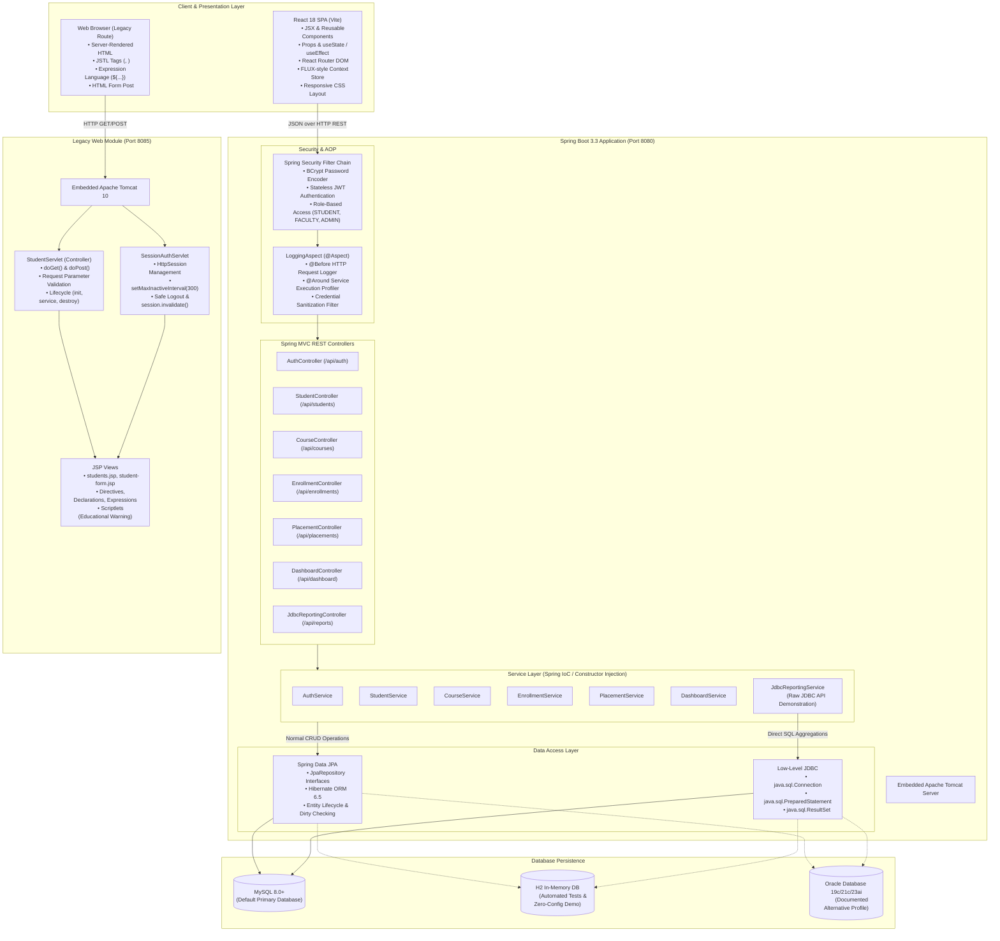

# CampusConnect — Student, Course, and Placement Management Portal

[](https://www.oracle.com/java/)
[](https://spring.io/projects/spring-boot)
[](https://react.dev/)
[](https://www.mysql.com/)
[](https://tomcat.apache.org/)
[](LICENSE)

CampusConnect is a complete, production-grade, educational enterprise web portal designed to demonstrate modern and classical Java full-stack web technologies. The project features student management, course enrollment rosters, and placement hiring pipelines.

---

## Architecture Diagram



---

## Technology-to-Feature Mapping Checklist

| Technology | Where & How It Is Implemented | Source File References |
| :--- | :--- | :--- |
| **Java & OOP** | Domain models, inheritance, polymorphism, encapsulation, DTOs, custom exceptions, interfaces | [`com.campusconnect.model.*`](file:///campus-connect/backend/src/main/java/com/campusconnect/model/) |
| **Spring Framework & Boot** | Layered enterprise architecture, `@SpringBootApplication`, automatic configuration | [`CampusConnectApplication.java`](file:///campus-connect/backend/src/main/java/com/campusconnect/CampusConnectApplication.java) |
| **Spring MVC & REST** | RESTful HTTP endpoints (`@RestController`, `@GetMapping`, `@PostMapping`, `@PutMapping`, `@DeleteMapping`, `@Valid`, `@RequestBody`) | [`com.campusconnect.controller.*`](file:///campus-connect/backend/src/main/java/com/campusconnect/controller/) |
| **Spring Data JPA** | Automatic CRUD, custom JPQL queries, pagination, entities with `@Table`, `@Id`, `@ManyToOne`, `@OneToOne` | [`com.campusconnect.repository.*`](file:///campus-connect/backend/src/main/java/com/campusconnect/repository/) |
| **Low-Level JDBC** | Real analytical reporting service using `DriverManager`/`DataSource`, `Connection`, `PreparedStatement`, `Statement`, `ResultSet`, `ResultSetMetaData` | [`JdbcReportingService.java`](file:///campus-connect/backend/src/main/java/com/campusconnect/service/JdbcReportingService.java) |
| **Spring DI & IoC** | Constructor injection across all classes; educational component contrasting constructor vs `@Autowired` field vs setter injection | [`DependencyInjectionDemoComponent.java`](file:///campus-connect/backend/src/main/java/com/campusconnect/config/DependencyInjectionDemoComponent.java) |
| **Spring AOP** | `@Aspect`, `@Pointcut`, `@Before` logging controller invocations with password sanitization; `@Around` execution profiling | [`LoggingAspect.java`](file:///campus-connect/backend/src/main/java/com/campusconnect/aop/LoggingAspect.java) |
| **Embedded Tomcat** | Spring Boot embedded Tomcat container on port 8080; standalone embedded Tomcat 10 on port 8085 for legacy module | [`pom.xml`](file:///campus-connect/backend/pom.xml), [`LegacyTomcatServer.java`](file:///campus-connect/legacy-web/src/main/java/com/campusconnect/legacy/LegacyTomcatServer.java) |
| **MySQL Database** | Primary database DDL schema, foreign keys, cascades, realistic seed data, and analytical SQL queries | [`mysql-schema.sql`](file:///campus-connect/database/mysql-schema.sql), [`mysql-seed.sql`](file:///campus-connect/database/mysql-seed.sql) |
| **Oracle Database** | Documented alternative database profile (`application-oracle.properties`) and compatible DDL schema | [`oracle-schema-compatible.sql`](file:///campus-connect/database/oracle-schema-compatible.sql), [`application-oracle.properties`](file:///campus-connect/backend/src/main/resources/application-oracle.properties) |
| **Servlets & MVC** | Classic controller servlet intercepting requests, validating parameters, setting request attributes, and forwarding to views | [`StudentServlet.java`](file:///campus-connect/legacy-web/src/main/java/com/campusconnect/legacy/servlet/StudentServlet.java) |
| **Servlet Lifecycle** | Live demonstration of container-managed `init(config)`, `service(req, resp)`, and `destroy()` | [`LifecycleDemoServlet.java`](file:///campus-connect/legacy-web/src/main/java/com/campusconnect/legacy/servlet/LifecycleDemoServlet.java) |
| **HttpSession** | Stateful session tracking using `getSession()`, `setAttribute()`, `setMaxInactiveInterval(300)`, and safe logout via `session.invalidate()` | [`SessionAuthServlet.java`](file:///campus-connect/legacy-web/src/main/java/com/campusconnect/legacy/servlet/SessionAuthServlet.java) |
| **JSP & JSTL** | Server-side JSP views rendering student roster with `<c:forEach>`, `<c:if>`, `<c:choose>`, `<c:when>`, `<c:otherwise>`, and EL `${...}` | [`students.jsp`](file:///campus-connect/legacy-web/src/main/webapp/WEB-INF/views/students.jsp) |
| **JSP Directives & Scriptlets** | Educational examples of `<%@ page %>`, `<%@ taglib %>`, `<%! %>` declarations, `<%= %>` expressions, and `<% %>` scriptlets with pedagogical warnings | [`students.jsp`](file:///campus-connect/legacy-web/src/main/webapp/WEB-INF/views/students.jsp) |
| **React 18 & JSX** | Modern frontend SPA with reusable components, props, state, event handlers (`onClick`, `onChange`, `onSubmit`), conditional rendering | [`frontend/src/pages/*`](file:///campus-connect/frontend/src/pages/) |
| **React Router** | Client-side routing with `BrowserRouter`, `Routes`, `Route`, `NavLink`, and `useNavigate` | [`App.jsx`](file:///campus-connect/frontend/src/App.jsx) |
| **Unidirectional Flow & FLUX** | Central action dispatching (`useReducer`), immutable store state, action stream logger, and live interactive FLUX visualizer | [`AuthContext.jsx`](file:///campus-connect/frontend/src/context/AuthContext.jsx), [`FluxArchitecturePage.jsx`](file:///campus-connect/frontend/src/pages/FluxArchitecturePage.jsx) |
| **Security & Passwords** | Real password authentication using BCrypt hashing (`BCryptPasswordEncoder`); stateless JWT Bearer token generation and verification | [`SecurityConfig.java`](file:///campus-connect/backend/src/main/java/com/campusconnect/security/SecurityConfig.java), [`JwtTokenProvider.java`](file:///campus-connect/backend/src/main/java/com/campusconnect/security/JwtTokenProvider.java) |

---

## Prerequisites

- **Java Development Kit (JDK):** Version 17 LTS or higher
- **Apache Maven:** Version 3.8+ (or 3.9+)
- **Node.js:** Version 18.x or higher & npm
- **Database (Optional for Zero-Config):** MySQL 8.0+ (The application defaults to in-memory H2 if MySQL is not running locally, allowing instant review with zero external dependencies!)

---

## Demo Credentials Matrix

The system includes pre-seeded accounts for each role with password `password123`:

| Role | Username | Password | Full Name / Description |
| :--- | :--- | :--- | :--- |
| **ADMIN** | `admin` | `password123` | Dr. Sarah Mitchell &bull; Full CRUD, system reporting, deleting profiles |
| **FACULTY** | `prof_john` | `password123` | Prof. John Doe &bull; Course catalog management, student grading, reviewing applicants |
| **STUDENT** | `alex_chen` | `password123` | Alex Chen (CS, Year 4, GPA 3.85) &bull; View enrollments, apply for placements |
| **STUDENT** | `priya_sharma`| `password123` | Priya Sharma (CS, Year 4, GPA 3.92) &bull; Placed at Google Cloud Labs |
| **STUDENT** | `marcus_vance`| `password123` | Marcus Vance (IT, Year 3, GPA 3.45) &bull; Active applicant |

---

## Quick Start: Running the Modules

### Module 1: Spring Boot REST Backend (Port 8080)

```bash
# 1. Navigate to the backend directory
cd campus-connect/backend

# 2. Run automated tests (verifies H2/Tomcat context, Mockito tests, controllers)
mvn clean test

# 3. Start the Spring Boot backend
mvn spring-boot:run
```
*The backend starts at `http://localhost:8080` on embedded Apache Tomcat.*
- Health Check: `http://localhost:8080/api/health`
- H2 Web Console: `http://localhost:8080/h2-console` (JDBC URL: `jdbc:h2:mem:campus_connect`, User: `sa`, Password: empty)
- Low-Level JDBC Report: `http://localhost:8080/api/reports/department-analytics`

---

### Module 2: React Modern Frontend (Port 5173)

```bash
# 1. Navigate to the frontend directory
cd campus-connect/frontend

# 2. Run frontend unit tests (verifies FLUX reducer, form validations, URL builders)
npm test

# 3. Start the Vite development server
npm run dev
```
*The frontend opens at `http://localhost:5173` with instant 1-click demo logins for Admin, Faculty, and Student.*

---

### Module 3: Legacy Java Web (Servlets, JSP, JSTL) (Port 8085)

```bash
# 1. Navigate to the legacy-web directory
cd campus-connect/legacy-web

# 2. Run legacy servlet unit tests
mvn clean test

# 3. Launch the standalone Embedded Tomcat server
mvn compile exec:java
```
*The legacy portal starts at `http://localhost:8085/` on standalone embedded Tomcat:*
- Overview: `http://localhost:8085/`
- Student Roster (JSTL & MVC): `http://localhost:8085/students`
- Add Student Form (`doPost` Validation): `http://localhost:8085/students/new`
- Servlet Lifecycle Telemetry (`init`, `service`, `destroy`): `http://localhost:8085/lifecycle`
- `HttpSession` & Safe Logout: `http://localhost:8085/session`

---

## Database Configuration

### 1. MySQL (Primary Production Database)
1. Ensure your MySQL server is running on `localhost:3306`.
2. Run the initialization script:
   ```bash
   mysql -u root -p < campus-connect/database/mysql-schema.sql
   mysql -u root -p < campus-connect/database/mysql-seed.sql
   ```
3. Set your environment variables in `.env` or in your terminal:
   ```bash
   SPRING_PROFILES_ACTIVE=mysql
   DB_HOST=localhost
   DB_PORT=3306
   DB_NAME=campus_connect
   DB_USERNAME=root
   DB_PASSWORD=your_password
   ```

### 2. Zero-Config Local Mode (H2 in MySQL-Compatibility Mode)
If MySQL is not installed locally, you don't have to install it! The application automatically activates the `h2` fallback profile:
- Automatically loads all seed data via [`DataInitializer.java`](file:///campus-connect/backend/src/main/java/com/campusconnect/config/DataInitializer.java).
- Fully supports all JPA operations and low-level JDBC queries identically.

### 3. Oracle Database (Documented Enterprise Compatibility Profile)
To connect to an Oracle Database instance (e.g. Oracle XE 21c or Oracle 23ai):
1. Execute [`oracle-schema-compatible.sql`](file:///campus-connect/database/oracle-schema-compatible.sql).
2. Set the active profile:
   ```bash
   SPRING_PROFILES_ACTIVE=oracle
   ORACLE_HOST=localhost
   ORACLE_PORT=1521
   ORACLE_SERVICE_NAME=FREEPDB1
   ORACLE_USERNAME=c##campus_user
   ORACLE_PASSWORD=oracle_password
   ```

---

## In-Depth Architectural Comparisons

### 1. Low-Level JDBC vs. Spring Data JPA
- **Low-Level JDBC (`java.sql.*`):**
  - **Mechanisms:** Uses `DriverManager` / `DataSource.getConnection()`, `PreparedStatement`, `Statement`, `ResultSet`, and `ResultSetMetaData`.
  - **Where used:** [`JdbcReportingService.java`](file:///campus-connect/backend/src/main/java/com/campusconnect/service/JdbcReportingService.java).
  - **Rationale:** Computes analytical aggregations across 4 tables with `GROUP BY` and `HAVING`. Bypasses ORM overhead and avoids pulling entire entity graphs into Hibernate's 1st-level cache.
- **Spring Data JPA:**
  - **Mechanisms:** Interfaces extending `JpaRepository<T, ID>`, Hibernate ORM, `@Entity`, `@OneToMany`, `@ManyToOne`.
  - **Where used:** [`StudentService.java`](file:///campus-connect/backend/src/main/java/com/campusconnect/service/StudentService.java), [`CourseService.java`](file:///campus-connect/backend/src/main/java/com/campusconnect/service/CourseService.java), etc.
  - **Rationale:** Drastically reduces boilerplate for standard CRUD operations, enforces relationship integrity, and leverages automatic dirty-checking upon transaction commit.

### 2. Modern React SPA vs. Classic Servlets & JSP
- **Classic Servlet & JSP (MVC Model 2):**
  - The server renders HTML strings upon every request and sends full document payloads over the network.
  - State is stored server-side in `HttpSession`.
  - Flow: Browser Form Submit &rarr; `StudentServlet.doPost()` &rarr; Validation &rarr; `RequestDispatcher.forward()` / `response.sendRedirect()`.
- **Modern React SPA:**
  - The browser loads a JavaScript bundle once; data flows over HTTP as JSON payloads.
  - State is managed client-side in React component state or FLUX Context stores.
  - Provides instant UI feedback, loading spinners, and seamless transitions without full page reloads.

### 3. FLUX Architecture vs. MVC
- **Classic MVC:**
  - Two-way relationships between controllers and views can lead to cascading updates and difficulty in debugging state changes.
- **FLUX (Unidirectional Data Flow):**
  - State moves strictly in a single loop: **Action &rarr; Dispatcher &rarr; Reducer (Store) &rarr; View**.
  - Demonstrated interactively in [`FluxArchitecturePage.jsx`](file:///campus-connect/frontend/src/pages/FluxArchitecturePage.jsx) and [`AuthContext.jsx`](file:///campus-connect/frontend/src/context/AuthContext.jsx).

---

## Sample SQL Queries

Check [`database/sample-queries.sql`](file:///campus-connect/database/sample-queries.sql) for practical queries including:
- Top-performing students by GPA
- Multi-table `INNER JOIN` of student enrollments
- Department course aggregations (`GROUP BY` & `HAVING`)
- Placement selection rates and CTC calculations

---

## Troubleshooting Guide

1. **Port 8080 already in use:**
   - Override the port using `--server.port=8081` or setting environment variable `PORT=8081`.
2. **Legacy port 8085 already in use:**
   - Launch with `mvn compile exec:java -Dlegacy.port=8090`.
3. **Database connection failed:**
   - Verify MySQL service is running, or simply omit `SPRING_PROFILES_ACTIVE` to let the app run in zero-config `h2` mode.
4. **PowerShell execution policy blocks `npm`:**
   - In PowerShell, run `npm.cmd run dev` or `npm.cmd test`.
